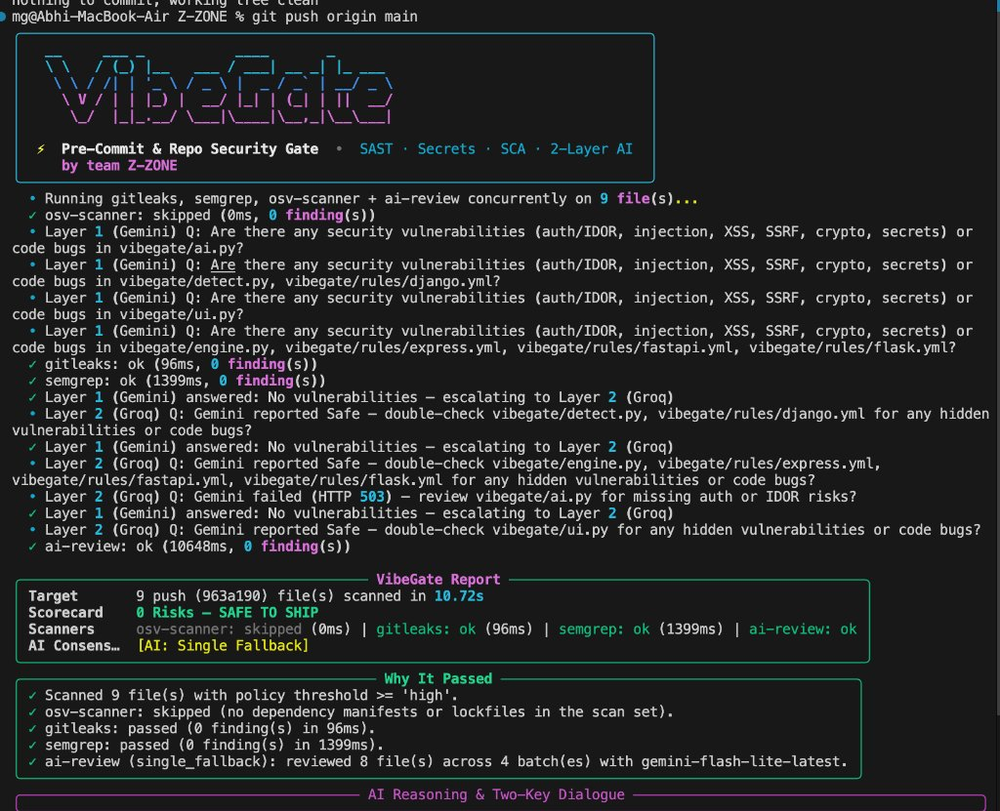

```text
 __     ___ _           ____       _
 \ \   / (_) |__   ___ / ___| __ _| |_ ___
  \ \ / /| | '_ \ / _ \ |  _ / _` | __/ _ \
   \ V / | | |_) |  __/ |_| | (_| | ||  __/
    \_/  |_|_.__/ \___|\____|\__,_|\__\___|
 ⚡ Pre-Commit & Repo Security Gate • SAST · Secrets · SCA · 2-Layer AI
    by team Z-ZONE
```

# VibeGate

A local-first security gate for AI-generated code. VibeGate scans **remote Git repositories**, **local/downloaded folders**, **single unuploaded files**, **staged Git changes** (pre-commit), or **outgoing commits** (`git push` pre-push)—combining deterministic cybersecurity scanners (**Gitleaks**, **Semgrep**, **OSV-Scanner**) with **2-Layer Multi-LLM Consensus** (**Gemini + Groq**).

VibeGate automatically detects your project stack (**Django**, **Flask**, **FastAPI**, **Express**), applies framework-specific rules and AI guidance across all files, shows the exact file, line, pinpointed code snippet, **How to Access / Example** exploit vector, and **Threat / Impact** in plain English, supports one-keystroke auto-fixing (`[A] Apply all safe fixes & re-stage`), and reruns checks after a change.



## Quick Start

Run the launcher script (automatically creates `.venv` and installs VibeGate on first run):

```bash
./run_app.sh
```

The interactive menu lets you choose:
1. **Git repository URL** — clones all files temporarily, scans them, shows the report, and deletes the temporary clone automatically
2. **Local project folder / downloaded directory**
3. **Single local file** (for testing unuploaded files on your system)
4. **Environment check** (`doctor`)
5. **Built-in security rules** (`rules`)
6. **90-second live demo** (`./run_app.sh demo`)

You can also pass a target directly:

```bash
./run_app.sh https://github.com/owner/repo.git
./run_app.sh /path/to/local/project
./run_app.sh /path/to/my_file.py
```

## Setup

Install the deterministic scanners (macOS / Homebrew):

```bash
brew install gitleaks semgrep osv-scanner
```

Check your environment:

```bash
./run_app.sh doctor
```

### Optional AI Authorization Review

Copy `.env.example` to `.env` (`.env` is gitignored) and add your Gemini API key:

```env
GEMINI_API_KEY=your-key-here
```

If `GEMINI_API_KEY` is not set or the API times out/is unavailable, VibeGate still runs all deterministic scanners and explicitly reports that AI review was skipped/unavailable.

## Commands

```bash
# Scan a remote Git repo (clones temporarily, scans, then deletes clone)
vibegate scan https://github.com/owner/repo.git

# Scan a local folder or single file
vibegate scan /path/to/project --all
vibegate scan /path/to/file.py

# Scan staged Git changes (default inside a Git repo)
vibegate scan

# Include dependency/library CVE scanning (OSV-Scanner)
vibegate scan --all --deps

# CI mode + JSON output + save report to a file
vibegate scan --all --ci --json
vibegate scan --all --output vibegate-report.json

# List all 18 built-in cybersecurity rules
vibegate rules

# Inspect or clear .vibegate-ignore.json suppressions
vibegate suppressions list
vibegate suppressions clear

# Install / uninstall the Git pre-commit hook
vibegate hook install
vibegate hook uninstall

# Create a .vibegate.toml config file
vibegate init
```

## What VibeGate Detects

- **Hard-coded secrets** via Gitleaks (API keys, tokens, private keys — masked in all outputs and redacted before any AI call)
- **Code-level cybersecurity threats** via 18 bundled offline Semgrep rules:
  - SQL injection (Python & JS/TS)
  - OS command injection (`subprocess(..., shell=True)`, `os.system`, `exec`)
  - Server-Side Template Injection (SSTI) & Cross-Site Scripting (XSS)
  - Server-Side Request Forgery (SSRF) & Path Traversal
  - Unsafe deserialization (`yaml.load`, `pickle.loads`) & `eval`/`exec`
  - Disabled TLS verification (`verify=False`, `rejectUnauthorized: false`), weak hashes (`md5`/`sha1`), hardcoded Flask `secret_key`, and Flask `debug=True`
- **Access-control / IDOR candidates** via optional Gemini AI review
- **Dependency CVEs** via OSV-Scanner when `--deps` is enabled

## Safe Staged-Change & Patch Workflow

- **Staged-only scanning:** `vibegate scan` checks out the Git **index** (`git checkout-index`) into a temporary directory so scanners inspect what will actually be committed—not unstaged edits in your working tree.
- **Partial staging protection:** If a file is partially staged (`git add -p`), VibeGate flags it and refuses to auto-patch or auto-stage it.
- **Explicit patches & honest verification:** Supported deterministic findings (such as Python f-string SQL injection) show a unified diff and require confirmation before editing or staging. Afterward, VibeGate reruns the original scanner and reports precisely whether that rule still triggers (`fixed (rescan ok)` vs `still triggers`), rather than claiming the file is "Verified Safe."

## Demo

`demo/` contains a small Flask app with intentional issues for testing:
1. A committed test token in `demo/app.py` (Gitleaks)
2. A Python f-string SQL injection in `demo/app.py` (Semgrep — with reviewable patch + rescan)
3. A missing ownership check on `DELETE /orders/<order_id>` in `demo/app.py` (AI authorization review)
4. Vulnerable packages in `demo/requirements.txt` (OSV-Scanner with `--deps`)

Run a quick demo scan:

```bash
./run_app.sh demo/app.py --no-tui --no-ai
```
