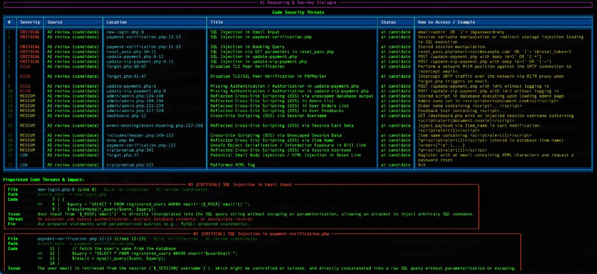
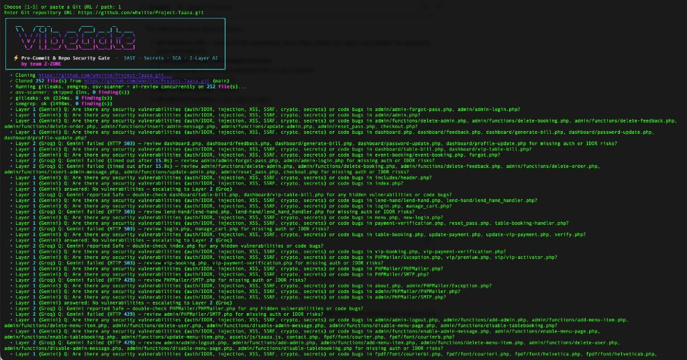

```text
 __     ___ _           ____       _
 \ \   / (_) |__   ___ / ___| __ _| |_ ___
  \ \ / /| | '_ \ / _ \ |  _ / _` | __/ _ \
   \ V / | | |_) |  __/ |_| | (_| | ||  __/
    \_/  |_|_.__/ \___|\____|\__,_|\__\___|
 ⚡ Pre-Commit & Repo Security Gate • SAST · Secrets · SCA · 2-Layer AI
```

# VibeGate

A local-first security gate for AI-generated code. VibeGate scans **remote Git repositories**, **local/downloaded folders**, **single unuploaded files**, **staged Git changes** (pre-commit), or **outgoing commits** (`git push` pre-push)—combining deterministic cybersecurity scanners (**Gitleaks**, **Semgrep**, **OSV-Scanner**) with **2-Layer Multi-LLM Consensus** (**Gemini + Groq**).

VibeGate automatically detects your project stack (**Django**, **Flask**, **FastAPI**, **Express**), applies framework-specific rules and AI guidance across all files, shows the exact file, line, pinpointed code snippet, **How to Access / Example** exploit vector, and **Threat / Impact** in plain English, supports one-keystroke auto-fixing (`[A] Apply all safe fixes & re-stage`), and reruns checks after a change.


### Multi-File Threat Table & Pinpointed Impact

When vulnerabilities are detected, VibeGate lists findings across **every file** in the project—complete with a **`How to Access / Example`** column showing concrete exploit vectors (such as SQL injection inputs, XSS payloads, and unauthenticated endpoints) alongside **Pinpointed Code Threats & Impact** cards with the exact vulnerable lines, plain-English threat explanation, and remediation:



### Live 2-Layer AI Reasoning & Multi-Batch Consensus

On full repositories, VibeGate batches all candidate files and streams its **2-Layer AI Reasoning** live—asking **Layer 1 (Gemini)** per file batch, escalating to **Layer 2 (Groq)** for a second opinion when Layer 1 reports safe, and automatically failing over between models on rate limits or timeouts so no file is skipped:



## Quick Start

Run the launcher script (automatically creates `.venv` and installs VibeGate on first run):

```bash
./run_app.sh
```

The interactive menu lets you choose:
1. **Git repository URL** — clones all files temporarily, scans them, shows the report, and deletes the temporary clone automatically
2. **Local project folder / downloaded directory**
3. **Single local file** (for testing unuploaded files on your system)
4. **Environment check** (`doctor`)
5. **Built-in security rules** (`rules`)
6. **90-second live demo** (`./run_app.sh demo`)

You can also pass a target directly:

```bash
./run_app.sh https://github.com/owner/repo.git
./run_app.sh /path/to/local/project
./run_app.sh /path/to/my_file.py
```

## Setup

Install the deterministic scanners (macOS / Homebrew):

```bash
brew install gitleaks semgrep osv-scanner
```

Check your environment:

```bash
./run_app.sh doctor
```

### Optional Multi-Key AI Security Consensus

Copy `.env.example` to `.env` (`.env` is gitignored) and add **1, 2, or as many API keys as you want** across Gemini, Groq, OpenAI, Anthropic, OpenRouter, Mistral, DeepSeek, Together, xAI, or custom OpenAI-compatible endpoints:

```env
GEMINI_API_KEY=your-key-here
GROQ_API_KEY=your-key-here
# Add more anytime (comma-separated or numbered):
# GEMINI_API_KEYS=key2,key3
# GROQ_API_KEY_2=...
# OPENAI_API_KEY=...
```

- **1 key**: executes all 5 security tasks (Auth/IDOR, Injections, Secrets/Crypto/TLS, Logic Bugs, Impact & Fix) across every file batch.
- **2+ keys**: run consensus & Synthesis Judge tie-breaking, and automatically rotate across batches on multi-file repositories.
- If no API keys are set or an API is unavailable, VibeGate still runs all deterministic scanners and reports AI status transparently.

## Commands

```bash
# Scan a remote Git repo (clones temporarily, scans, then deletes clone)
vibegate scan https://github.com/owner/repo.git

# Audit a live hosted domain (HTTPS/TLS, headers, cookies, CORS, JS bundles, exposures)
vibegate audit https://yoursite.com
vibegate audit yoursite.in --report-md site-audit.md

# Scan a local folder or single file
vibegate scan /path/to/project --all
vibegate scan /path/to/file.py

# Scan staged Git changes (default inside a Git repo) or outgoing push commits
vibegate scan
vibegate scan --push

# Include dependency/library CVE scanning (OSV-Scanner)
vibegate scan --all --deps

# CI mode + JSON, Markdown, and SARIF 2.1.0 exports
vibegate scan --all --ci --json
vibegate scan --all --output vibegate-report.json --report-md report.md --sarif vibegate.sarif

# List all built-in cybersecurity rules
vibegate rules

# Inspect or clear .vibegate-ignore.json suppressions
vibegate suppressions list
vibegate suppressions clear

# Install / uninstall Git pre-commit & pre-push hooks (local or global)
vibegate hook install
vibegate hook install --global --which all
vibegate hook uninstall

# Create a .vibegate.toml config file
vibegate init
```

## Hosted Website Security Audit (`vibegate audit`)

Paste any domain you own or are authorized to test (`.com`, `.in`, `.app`, etc.) after deploying to get an **A+ to F Security Grade** and an **A-to-Z Hosted Site Security Checklist**:

- **Transport & TLS**: HTTP-to-HTTPS redirect (with automatic HTTP fallback if port 443 is closed), legacy TLS (`1.0`/`1.1`), invalid/expiring certificates, mixed content, and cleartext password forms.
- **Security Headers & CORS**: `Strict-Transport-Security`, `Content-Security-Policy`, `X-Frame-Options`, `X-Content-Type-Options: nosniff`, `Referrer-Policy`, `Permissions-Policy`, `Cache-Control: no-store`, version disclosure, and wildcard CORS (`*`).
- **Cookies & Sessions**: `Set-Cookie` flags missing `HttpOnly`, `Secure`, or `SameSite`.
- **Public Exposures**: checks for accidentally exposed `/.env`, `/.git/HEAD`, `/.DS_Store`, `/phpinfo.php`, and `/openapi.json`.
- **HTML & JS Bundles**: passively inspects linked same-origin `<script src="...">` bundles for leaked API keys, debug traces, and POST forms missing CSRF tokens.

## What VibeGate Detects

- **Hard-coded secrets** via Gitleaks (API keys, tokens, private keys — masked in all outputs and redacted before any AI call)
- **Stack-aware SAST** via bundled offline Semgrep rules (automatically detects **Django**, **Flask**, **FastAPI**, and **Express** and loads matching framework rules):
  - SQL injection (Python, JS/TS, Django `.extra()` / `RawSQL`)
  - OS command injection (`subprocess(..., shell=True)`, `os.system`, `exec`)
  - Server-Side Template Injection (SSTI) & Cross-Site Scripting (XSS)
  - Server-Side Request Forgery (SSRF) & Path Traversal
  - Unsafe deserialization (`yaml.load`, `pickle.loads`) & `eval`/`exec`
  - Disabled TLS verification, weak hashes (`md5`/`sha1`), `@csrf_exempt`, missing `@login_required`, `DEBUG=True`, and `ALLOWED_HOSTS=['*']`
- **Access-control / IDOR & logic bugs** via multi-key AI consensus review across all project files
- **Dependency CVEs** via OSV-Scanner when `--deps` is enabled
- **Grounded reporting**: every finding shows **`Type`**, **`If Unfixed`**, **`How to Access / Example`**, and **`Fix`**

## Safe Staged-Change & Patch Workflow

- **Staged-only scanning:** `vibegate scan` checks out the Git **index** (`git checkout-index`) into a temporary directory so scanners inspect what will actually be committed—not unstaged edits in your working tree.
- **Partial staging protection:** If a file is partially staged (`git add -p`), VibeGate flags it and refuses to auto-patch or auto-stage it.
- **Explicit patches & honest verification:** Supported deterministic findings (such as Python f-string SQL injection) show a unified diff and require confirmation before editing or staging. Afterward, VibeGate reruns the original scanner and reports precisely whether that rule still triggers (`fixed (rescan ok)` vs `still triggers`), rather than claiming the file is "Verified Safe."

## Demo

`demo/` contains a small Flask app with intentional issues for testing:
1. A committed test token in `demo/app.py` (Gitleaks)
2. A Python f-string SQL injection in `demo/app.py` (Semgrep — with reviewable patch + rescan)
3. A missing ownership check on `DELETE /orders/<order_id>` in `demo/app.py` (AI authorization review)
4. Vulnerable packages in `demo/requirements.txt` (OSV-Scanner with `--deps`)

Run a quick demo scan:

```bash
./run_app.sh demo/app.py --no-tui --no-ai
```
